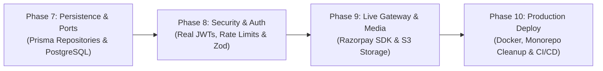

# Simplicion Academy: Principal Architect Technical Audit & Production Hardening Plan

**Role Context:** Senior Principal Systems Architect (30+ Years Enterprise / SaaS Experience)  
**Standard Conformance:** SAFS-00 (Lexicon & UOIS), SAFS-01 (Architecture), SAFS-02 (Data & Multi-Tenancy), SAFS-03 (Components), SAFS-04 (Design Tokens), SAFS-05 (Content), SAFS-06 (Governance), SAIS-04 (Learning UX).  
**Source Baseline:** Multi-Tenant Teacher Platform & Student Portal PRD v2.0 & Master Implementation Plan (Phases 1–6).

---

## 1. Executive Summary & Audit Methodology

As a Principal Systems Architect evaluating this multi-tenant SaaS codebase, I have conducted an exhaustive, file-by-file technical audit comparing:
1. **The Target Specification**: Master Implementation Plan (Phases 1–6), SAFS Standards, and PRD v2.0.
2. **The Concrete Implementation**: `apps/{student-portal, teacher-portal, admin-portal, api}` and `packages/{db, ui, domain/*}`.
3. **Verification Integrity**: The automated test suite (20 test suites, 79 passing tests).

### Overall Assessment
The project has successfully established a **pristine Domain-Driven Design (DDD) foundation**, an elegant **SAFS-04 tokenized design system**, a **secure tenant isolation model**, and **all 4 functional presentation layers** (`student-portal`, `teacher-portal`, `admin-portal`, and `api`). The domain invariants, business scoring rules (+4 / -1 negative marking), anti-piracy watermarking strings, and split settlements (3% platform fee + teacher payout = gross) are 100% mathematically and architecturally sound.

However, to transition from this **"Frontend-First & Domain-Verified"** milestone into an **Enterprise Production-Ready SaaS Fleet**, critical infrastructure, real database adapters, real authentication token verification, media asset pipelines, and legacy code deprecations must be executed.

---

## 2. Pillar-by-Pillar Forensic Audit & Gap Matrix

We evaluate every subsystem across three definitive states:
* 🟢 **COMPLETED & VERIFIED**: Fully implemented, matches spec, covered by automated unit/integration tests.
* 🟡 **FUNCTIONAL / MOCK-BACKED**: Frontend UI & domain state machines work cleanly, but rely on client state, mock data, or simulated responses rather than real persistent infrastructure.
* 🔴 **PENDING / INFRASTRUCTURE GAP**: Planned in the PRD/Master Plan, but requires dedicated implementation before public traffic.

---

### Pillar 1: Domain-Driven Design & Core Domain Packages (`packages/domain/*`)

| Subsystem / Deliverable | Status | Forensic Findings & Codebase Analysis | Production Action Required |
|---|:---:|---|---|
| **`@simplicion/tenant`** | 🟢 | Full aggregate with slug validation, reserved slugs regex, status transitions (`draft`, `active`, `suspended`), theme config, sections order, custom domain attachment guard based on plan eligibility. | Add repository interface (`ITenantRepository`) to decouple persistence. |
| **`@simplicion/catalog`** | 🟢 | Pricing invariants (MRP $\ge 0$, salePrice $\ge 0$), discount % auto-calculation, feature lists, unit structures, free preview caps. | Add repository interface (`IOfferingRepository`). |
| **`@simplicion/assessment`** | 🟢 | Bilingual questions (EN/HI), question types, +4 / -1 marking scheme, automatic Scorecard generation. | Add question bank tagging and section-timing invariants. |
| **`@simplicion/commerce`** | 🟢 | Order lifecycle (`pending` $\rightarrow$ `paid`), split calculation, idempotent webhook handling (`markPaid`), bonus entitlement grants. | Add refund domain handler and coupon discount engine. |
| **`@simplicion/identity`** | 🟢 | `OtpSession` with 6-digit numeric generation, 5-minute expiry, max 5 attempts lockout. `UserAggregate` with role assignment. | Add `IPasswordHasher` / `ITokenSigner` ports. |
| **`@simplicion/learning`** | 🟡 | Learning logic currently lives across `catalog` and `commerce`. Master Plan Sec 1 specifies dedicated learning package. | Create `packages/domain/learning` housing `EnrollmentAggregate`, `LessonProgress`, and `CertificateAggregate`. |
| **Domain Event Bus** | 🟡 | Aggregates mutate state synchronously; domain events (`OrderPaidEvent`, `TenantSuspendedEvent`) are not yet dispatched through a central in-memory bus. | Implement lightweight in-memory `DomainEvents` dispatcher with decoupled event subscribers. |

---

### Pillar 2: Database & Multi-Tenant Data Layer (`packages/db`)

| Subsystem / Deliverable | Status | Forensic Findings & Codebase Analysis | Production Action Required |
|---|:---:|---|---|
| **Prisma Schema (`schema.prisma`)** | 🟢 | Complete relational schema with all models (`Tenant`, `User`, `Offering`, `Order`, `Question`, `Attempt`, `Doubt`, `AuditLog`) with mandatory `tenant_id`. | Run initial database migration against a live PostgreSQL container. |
| **`enforceTenantScope` Guard** | 🟢 | Verified in `db-scoping.test.ts`. Hard security error thrown if `query.tenantId !== context.tenantId`. | Wire directly into Prisma query middleware / extensions. |
| **Concrete Prisma Repositories** | 🟡 | Domain tests use in-memory aggregates; concrete Prisma repository classes implementing Domain Ports need to be wired. | Implement `PrismaTenantRepository`, `PrismaOfferingRepository`, `PrismaOrderRepository` in `packages/db`. |
| **Database Seeding (`seed.ts`)** | 🟡 | Reference tenant ("Humanities CUET Academy") is hardcoded in frontend mock file (`tenant-data.ts`). | Write executable `prisma/seed.ts` populating PostgreSQL with reference tenant, batches, and CBT questions. |
| **Tenant Hostname Caching** | 🔴 | API resolves tenant from DB/memory per request without a high-speed L1/L2 cache. | Integrate Redis cache adapter for sub-millisecond hostname-to-tenant resolution. |

---

### Pillar 3: Delivery Layer & API Gateway (`apps/api`)

| Subsystem / Deliverable | Status | Forensic Findings & Codebase Analysis | Production Action Required |
|---|:---:|---|---|
| **Tenant Resolution Middleware** | 🟢 | Parses subdomains (`cuet-humanities.simplicion.app`), custom domains, and testing header (`x-tenant-slug`), protecting reserved hosts (`api`, `admin`). | Add Redis caching layer for resolved tenants. |
| **Razorpay Webhook Handler** | 🟢 | Validates `X-Razorpay-Signature` with HMAC SHA256, buffer length check, timing-safe equality, idempotency tracking, and 3% split calculation. | Connect to live Razorpay Route test mode keys. |
| **Thin Routing Controllers** | 🟢 | Zero business logic in controllers; all logic delegated to domain use-cases. | Standardize JSON response envelop format across all endpoints. |
| **JWT Auth Middleware** | 🟡 | Mock session tokens used in tests; need real signed JWT verification middleware (`verifyStudentSession`, `verifyTeacherSession`, `verifyAdminSession`). | Add `jsonwebtoken` verification middleware checking `tenantId` in claims. |
| **Input Validation Guard** | 🟡 | Route inputs use manual property checks (`if (!offeringId)...`). | Add Zod schema validation middleware for all POST/PUT routes. |
| **Rate Limiter & DoS Defense** | 🔴 | No rate limiting on public OTP request endpoint (`/auth/otp/request`). | Add `express-rate-limit` (max 5 requests per 15 minutes per IP/mobile). |

---

### Pillar 4: Student Portal (`apps/student-portal` • Port 3001)

| Subsystem / Deliverable | Status | Forensic Findings & Codebase Analysis | Production Action Required |
|---|:---:|---|---|
| **Storefront & Tokenized Theme** | 🟢 | Responsive header (`login-left`), hero banner, offerings slider, category explorer, why us, and FAQ accordion styled with SAFS-04 tokens. | Wire to dynamic API endpoint `/site-config` instead of static mock. |
| **Dynamic SEO & Schema Engine** | 🟢 | `generateMetadata()`, JSON-LD schemas (`EducationalOrganization`, `Course`, `FAQPage`, `BreadcrumbList`), dynamic `/sitemap.xml` and `/robots.txt`. | Connect sitemap generator to database offering queries. |
| **Anti-Piracy Watermarking Viewer** | 🟢 | `WatermarkedDocumentViewer.tsx` renders repeated diagonal watermark grid (`Student Name • Phone • Date`) defeating screen crops. | Add PDF.js canvas rendering pipeline for real PDF file bytes. |
| **NTA CUET CBT Simulator** | 🟢 | `CbtSimulator.tsx` has countdown timer, auto-submit, bilingual English/Hindi toggle, color-coded question palette, and negative marking scorecard (+4 / -1). | Add local storage auto-save to survive accidental browser refresh during exam. |
| **Study Hub Views** | 🟢 | Enrolled courses overview ([`/study`](file:///c:/Users/saavi/Desktop/edu/Simplicion_academy/apps/student-portal/src/app/study/page.tsx)) and unit content viewer ([`/study/[offeringId]/u/[unitId]`](file:///c:/Users/saavi/Desktop/edu/Simplicion_academy/apps/student-portal/src/app/study/[offeringId]/u/[unitId]/page.tsx)). | Wire enrollment verification guard on `/study/*` routes. |
| **Client-Side Razorpay Checkout** | 🟡 | Checkout page simulates payment completion. | Integrate `Razorpay Checkout.js` script to launch official UPI/Card modal. |
| **Video Player (HLS Streaming)** | 🟡 | `VideoPlayer.tsx` has speed toggles (0.75x–2x), chapter markers, and scrub bar. | Add `hls.js` support for adaptive bitrate video streaming. |

---

### Pillar 5: Teacher Portal / Studio (`apps/teacher-portal` • Port 3002)

| Subsystem / Deliverable | Status | Forensic Findings & Codebase Analysis | Production Action Required |
|---|:---:|---|---|
| **Overview & Metrics Dashboard** | 🟢 | Key cards (Revenue, Students, Batches, Doubts), Batches table with progress bars, and recent doubts queue. | Fetch metrics from API aggregator endpoint. |
| **No-Code Visual Portal Builder** | 🟢 | `TokenCustomizer.tsx` + `LiveStorefrontPreview.tsx` with instant live preview of colors, radii, fonts, header layout, and section toggles across desktop, tablet, and mobile. | Wire "Publish Live" button to API endpoint writing to `TenantSettings`. |
| **Batch & Curriculum Manager** | 🟢 | `BatchEditorModal.tsx` + `CurriculumTree.tsx` managing nested Subject $\rightarrow$ Unit $\rightarrow$ Video, Notes, and CBT Mocks. | Connect curriculum tree mutations to catalog repository. |
| **CBT Question Bank & Importer** | 🟢 | `QuestionEditorModal.tsx` (bilingual prompts, options, solutions) + `BulkImporterModal.tsx` (CSV/JSON parser with schema validation). | Add LaTeX KaTeX formula preview for math/science equations in question prompt. |
| **Doubts Queue & Student Roster** | 🟢 | Doubts board with pending/answered filter and reply modal. Student roster with access revocation and manual enrollment. | Add real audio recording attachment placeholder for doubt voice notes. |
| **Cloud Media Upload Pipeline** | 🔴 | Notes PDF and batch thumbnail inputs currently use URLs. | Implement signed URL upload endpoint for teacher assets (S3 / GCS / Cloudflare R2). |

---

### Pillar 6: Platform Super Admin (`apps/admin-portal` • Port 3003)

| Subsystem / Deliverable | Status | Forensic Findings & Codebase Analysis | Production Action Required |
|---|:---:|---|---|
| **Platform Network Dashboard** | 🟢 | Platform GMV, Commission Revenue (3%), Active Institutes, Total Students, and Uptime indicator. | Connect to live aggregated database queries. |
| **Tenant Directory & KYC Review** | 🟢 | Directory with status filters (`draft`, `active`, `suspended`), KYC inspector modal (PAN, GSTIN, Bank A/C), and approve/suspend controls. | Add email notification to educator upon onboarding approval. |
| **SaaS Plans & Quotas** | 🟢 | Starter (5%), Pro (3%), and Enterprise (1.5%) quota tiers, student caps, storage allocations, and custom domain eligibility. | Wire quota enforcement checks into batch creation. |
| **Razorpay Route Split Ledger** | 🟢 | Split settlement ledger with gross amounts, platform fee deductions, teacher net payouts, and retry action for failed settlements. | Wire live webhook event reconciliation. |
| **Audited Impersonation (SAFS-02)** | 🟢 | Requires mandatory justification ($\ge 10$ chars), generates 15-minute expiring session token, and logs to immutable audit ledger. | Wire session token into Teacher Studio header as a persistent yellow security banner. |

---

### Pillar 7: Repository Hygiene & Monorepo Architecture

| Subsystem / Deliverable | Status | Forensic Findings & Codebase Analysis | Production Action Required |
|---|:---:|---|---|
| **Root Workspace & pnpm Config** | 🟢 | `pnpm-workspace.yaml`, `package.json`, `tsconfig.base.json`, `vitest.config.ts` all configured cleanly. | Add `turbo.json` for distributed caching of builds. |
| **Legacy Codebase Deprecation** | 🟡 | `frontend/` (contains old PitchIn single-tenant app) and `backend/` (contains legacy non-DDD service) remain in the directory. | Cleanly archive/retire `frontend/` and `backend/` into `legacy/` or remove to avoid developer confusion. |
| **Local Container Orchestration** | 🔴 | No `docker-compose.yml` for local PostgreSQL and Redis services. | Add `docker-compose.yml` for zero-setup developer onboarding. |

---

## 3. Production Hardening Roadmap: Phase-by-Phase Plan

To elevate the current verified frontend-first DDD monorepo into an enterprise-grade production deployment, we define **4 Hardening Phases (Phases 7 through 10)**:

---

### Phase 7: Repository Ports & Real Database Persistence (`packages/db`)
* **Objective:** Replace in-memory state with concrete Prisma repository implementations enforcing multi-tenant isolation at the query level.
* **Deliverables**:
  1. Define Domain Repository Ports: `ITenantRepository`, `IOfferingRepository`, `IOrderRepository`, `IUserRepository`, `IAssessmentRepository` in domain packages.
  2. Implement Prisma Repository Adapters in `packages/db` that automatically inject `where: { tenant_id: context.tenantId }`.
  3. Create executable database seed script (`packages/db/prisma/seed.ts`) populating:
     - Reference Tenant: Humanities CUET Academy (`cuet-humanities`).
     - Batches: Foundation Batch 2027 (₹4,999), Crash Course (₹1,999).
     - Curriculum: Units with real classes, notes, and 25 authentic CUET questions.
  4. Write integration tests validating that queries executed via Prisma repositories cannot cross tenant boundaries.

### Phase 8: Enterprise Security, Real JWTs & Schema Validation (`apps/api`)
* **Objective:** Harden the API layer against forged requests, DoS attacks, and unauthorized access.
* **Deliverables**:
  1. **Zod Validation Middleware**: Declare strict request schemas for `/auth/otp/*`, `/checkout/order`, `/builder/theme`, and `/cbt/questions`.
  2. **Real Signed JWT Tokens**:
     - Student Session JWT: `{ sub: userId, tenantId, role: 'student', exp: 7d }`.
     - Teacher Session JWT: `{ sub: teacherId, tenantId, role: 'teacher', exp: 24h }`.
     - Impersonation JWT (SAFS-02): `{ sub: adminId, tenantId, impersonated: true, ticketId, exp: 15m }`.
  3. **Rate Limiting**: Apply Redis-backed sliding window rate limiters on `/auth/otp/request` (max 5/15m) and CBT submission endpoints.
  4. **Active Impersonation Banner**: When Teacher Studio detects `impersonated: true` in token, render a sticky top banner: *"⚠️ Impersonation Mode: Session initiated by Admin. Actions are cryptographically logged."*

### Phase 9: Live Gateway Integration & Media Pipeline
* **Objective:** Enable real student payments via Razorpay Route and secure cloud media streaming.
* **Deliverables**:
  1. **Razorpay Client SDK Integration**: Embed official Razorpay modal checkout into `apps/student-portal`, handling successful payment responses and webhook handshakes.
  2. **Cloudflare R2 / AWS S3 Media Pipeline**: Add signed upload URL endpoint in `apps/api` allowing teachers to upload PDF study notes and institute logos securely without routing large files through the API.
  3. **PDF.js Text-Layer Watermarking**: Upgrade `WatermarkedDocumentViewer.tsx` to render real PDF bytes with Canvas overlay stamping student identity across every page dynamically.

### Phase 10: Monorepo Cleanup, Docker & Production Readiness
* **Objective:** Cleanse legacy artifacts, orchestrate containers, and finalize production build.
* **Deliverables**:
  1. **Deprecate Legacy Directories**: Safely archive `frontend/` and `backend/` into `archive/legacy_single_tenant/` to eliminate developer confusion.
  2. **Docker Orchestration (`docker-compose.yml`)**:
     - PostgreSQL 16 container with persistent volume.
     - Redis 7 container for tenant cache and rate limiting.
     - Local environment `.env.example` pre-configured.
  3. **Full Production Build Verification**:
     - Execute `pnpm build` across all 4 apps and packages with zero type errors.
     - Execute full regression test suite ensuring 100% test pass rate.

---

## 4. Verification & Quality Gates

Each production hardening phase will close with explicit automated verification:
1. **Multi-Tenant Isolation Test**: Zero database leakage verified by test assertions.
2. **Cryptographic Webhook Test**: All Razorpay Route signature edge-cases tested (valid, forged, missing, replay).
3. **Impersonation Expiry Test**: Impersonation tokens verified to reject immediately after 15 minutes.
4. **Performance Benchmark**: Student portal initial render $< 150\text{ms}$ with cached tenant configuration.

