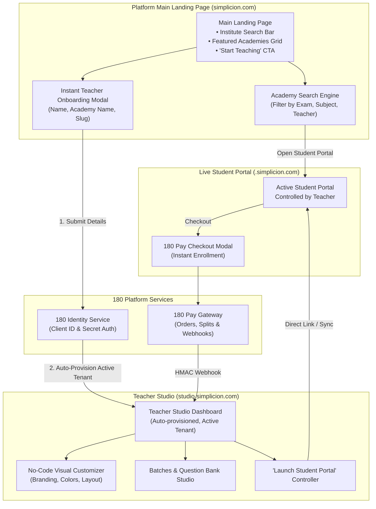

# Implementation Plan: Instant Self-Serve Teacher Onboarding, Main Discovery Hub & 180 Identity / 180 Pay Integration

**Status:** Proposed Architecture & Execution Plan  
**Standard Conformance:** SAFS-00, SAFS-01 (Architecture), SAFS-02 (Data & Security), SAFS-04 (Design System)

---

## 1. Executive Summary & Core Objectives

Per the user's instructions:
1. **Eliminate All Approval / KYC Gates for Teachers:**
   - Teachers must have an immediate, frictionless path to start.
   - Upon creating their teacher account, their institute tenant is auto-provisioned immediately in **`active`** status with zero approval delay.
   - They immediately receive access to their **Teacher Studio** (`http://localhost:3002`), customized with their institute name, branding controls, curriculum tree, and CBT question bank studio.
   - From Teacher Studio, they can customize their student portal and click **"Launch Student Portal"** to immediately open and control their live academy storefront.
2. **Main Platform Discovery & Search Landing Page:**
   - A dedicated platform discovery page (apex/root platform view):
     - **Portal Search Engine:** Prospective students and teachers can search active institutes/academies by name, exam (e.g., CUET, JEE, NEET, UPSC), or instructor, with instant links to open that teacher's student portal.
     - **"Start Your Academy" / "Create Teacher Account" CTA:** A streamlined onboarding modal that collects Teacher Name, Institute Name, desired Subdomain / Slug, and Subject Specialty.
     - Instant transition into the provisioned Teacher Studio.
3. **180 Identity Authentication Infrastructure:**
   - Integrate 180 Identity authentication using provided credentials:
     - `180_CLIENT_ID=180_client_3f697aec4c406a407979d708780106f0`
     - `180_CLIENT_SECRET=180_secret_50e7b13eb02eb99f90cbc8a276ca1fbe9d42b13ac8c485d4823089776b2f7ad9`
     - `180_WEBHOOK_SECRET=whsec_ba609675e3da1dcf164914fcfc410f53e8deab8e9756884d`
   - Signed session token verification and 180 Identity webhook handling.
4. **180 Pay Payment Infrastructure:**
   - Power student checkout orders, split settlements, and payment verification via 180 Pay utilizing the client credentials and webhook HMAC secret.

---

## 2. Architecture & Data Flow



---

## 3. Detailed Implementation Modules

### Module 1: Instant Self-Serve Teacher Onboarding (No Approval Gate)
- **Domain Layer (`packages/domain/tenant`):**
  - Add `TenantAggregate.createInstantSelfServe(id, slug, name, teacherId, email, plan = 'free_starter')`:
    - Sets `status: 'active'` immediately upon instantiation (bypassing `draft` and manual KYC verification).
    - Initializes default branding tokens (primary color, logo, font, standard responsive hero layout).
- **API Endpoint (`apps/api/src/controllers/tenant.controller.ts`):**
  - `POST /tenants/onboard-instant`:
    - Public endpoint accepting `{ teacherName, email, phone, academyName, slug, specialty }`.
    - Auto-generates tenant aggregate in `active` state and persists to database/store.
    - Generates 180 Identity signed teacher session token.
    - Returns `{ success: true, tenant, token, redirectUrl: 'http://localhost:3002/?tenantId=...' }`.

### Module 2: Main Platform Landing Page with Academy Search Engine
- **In `apps/student-portal/src/app/` (Apex/Platform Root View):**
  - Create `apps/student-portal/src/components/platform/MainPlatformLanding.tsx`:
    - **Header:** Simplicion Academy brand, "Explore Portals", and prominent "Start Your Academy" button.
    - **Hero Section:** "Launch Your Online Academy in 60 Seconds" — No credit card or approval required.
    - **Academy Search Bar:** Live search filtering available academies (e.g. "CUET Humanities", "Civil Services IAS", "NEET Biology", "Board Exam Maths").
    - **Featured Academies Directory:** Grid of live teacher portals with direct links to visit.
    - **Teacher Onboarding Modal (`TeacherOnboardingModal.tsx`):**
      - Instant form: Teacher Name, Email, Academy Name, Custom Slug (with live availability check).
      - On submit: Calls `POST /tenants/onboard-instant`, receives active session token, and opens **Teacher Studio** with a welcome confetti state.

### Module 3: Teacher Studio Control & Student Portal Launch Controller
- **In `apps/teacher-portal/src/components/layout/TeacherHeader.tsx` & Dashboard:**
  - Add prominent **"🚀 Launch / View Student Portal"** button in header:
    - Directly opens the teacher's active student portal in a new tab (`http://localhost:3001/?tenant=...`).
  - Add tenant switcher / status indicator showing **"🟢 Live & Active"** (no approval pending warnings).
  - Sync real-time branding changes directly so teachers see their updates reflected on their student portal immediately.

### Module 4: 180 Identity Authentication Service
- **Environment Configuration:**
  - Update `.env.example` and active `.env` with:
    ```env
    180_CLIENT_ID=180_client_3f697aec4c406a407979d708780106f0
    180_CLIENT_SECRET=180_secret_50e7b13eb02eb99f90cbc8a276ca1fbe9d42b13ac8c485d4823089776b2f7ad9
    180_WEBHOOK_SECRET=whsec_ba609675e3da1dcf164914fcfc410f53e8deab8e9756884d
    ```
- **Service Implementation (`apps/api/src/security/one80-identity.service.ts`):**
  - Implements token generation and cryptographic exchange with 180 Identity credentials.
  - Verifies incoming 180 Identity tokens and extracts tenant / user attributes.
  - Webhook signature validator enforcing HMAC SHA256 against `180_WEBHOOK_SECRET`.

### Module 5: 180 Pay Payment Integration
- **Backend Service (`apps/api/src/controllers/one80-pay.controller.ts`):**
  - `POST /pay/180/create-order`:
    - Initiates order with 180 Pay using `180_CLIENT_ID` and `180_CLIENT_SECRET`.
    - Automatically calculates teacher split (95%) and platform fee (5%).
  - `POST /webhooks/180-pay`:
    - Verifies HMAC SHA256 header using `180_WEBHOOK_SECRET`.
    - Dispatches `PaymentVerified` domain event to grant instant course access to student.
- **Frontend Component (`apps/student-portal/src/components/checkout/One80PayModal.tsx`):**
  - Unified checkout modal supporting 180 Pay with credit/debit card, UPI, and instant sandbox simulation.

---

## 4. Verification & Testing Plan

| Test File | Target Scope |
|---|---|
| `apps/api/test/instant-onboarding.test.ts` | Validates that teacher creation yields an immediately `active` tenant without manual approval steps. |
| `apps/api/test/one80-identity.test.ts` | Validates 180 Identity token generation, client secret authentication, and webhook signature verification. |
| `apps/api/test/one80-pay.test.ts` | Validates 180 Pay order creation, 95/5 split calculation, and HMAC SHA256 webhook fulfillment. |
| `apps/student-portal/test/platform-discovery.test.ts` | Validates academy search filtering by exam, teacher name, and instant redirect to student portal. |

---

## 5. Execution Steps
1. Configure `.env.example` and environment files with 180 credentials.
2. Implement 180 Identity Service and 180 Pay controller in `apps/api`.
3. Implement `TenantAggregate.createInstantSelfServe` and `POST /tenants/onboard-instant`.
4. Build `MainPlatformLanding.tsx`, search bar, and `TeacherOnboardingModal.tsx` in `apps/student-portal`.
5. Add "Launch Student Portal" button and real-time control link in `apps/teacher-portal`.
6. Integrate `One80PayModal.tsx` into Student Portal checkout flow.
7. Write automated test suites and verify 100% test pass rate across the monorepo.

