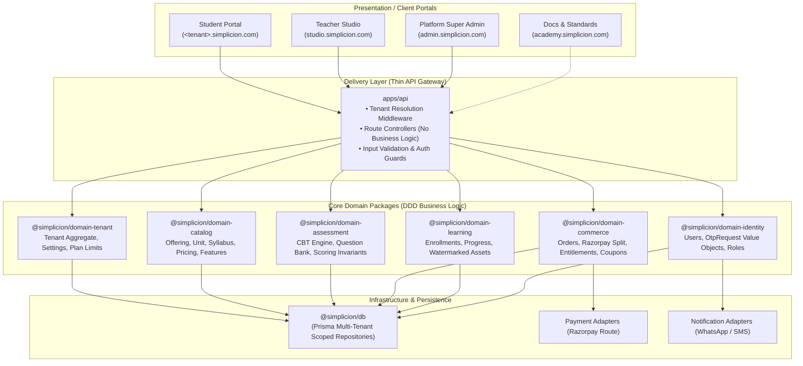
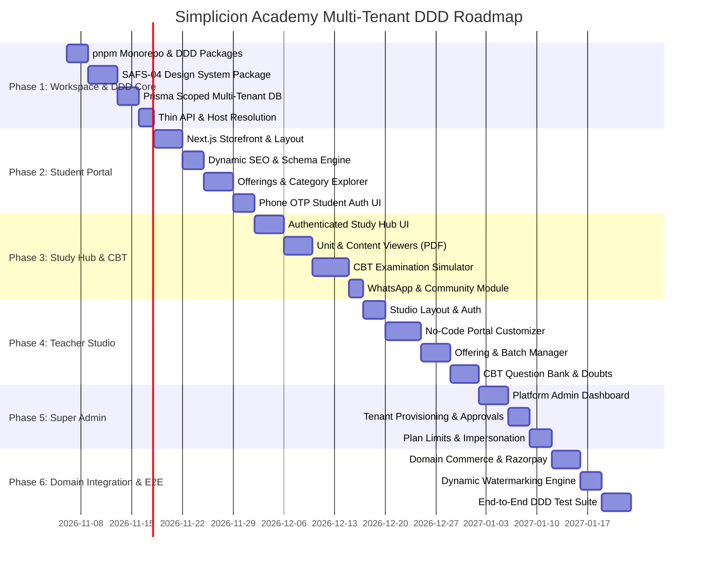

# Simplicion Academy: Master Multi-Tenant Platform Implementation Plan (DDD Edition)

**Standard Conformance:** SAFS-00 (Lexicon & UOIS), SAFS-01 (Architecture), SAFS-02 (Data Standards), SAFS-03 (Components), SAFS-04 (Design Standards), SAFS-05 (Content Standards), SAFS-06 (Governance), SAIS-04 (Learning Experience).  
**Source Specification:** Multi-Tenant Teacher Platform & Student Portal PRD v2.0.  
**Architectural Pattern:** **Domain-Driven Design (DDD)** with Hexagonal / Clean Architecture boundaries and a thin Delivery/API layer.

---

## 1. Domain-Driven Design (DDD) & System Architecture

In alignment with **SAFS-01 (Academy Architecture)** and **SAFS-02 (Canonical Data Models)**, the backend adheres strictly to **Domain-Driven Design (DDD)** principles:

* **Thin API / Delivery Layer (`apps/api`):**  
  Responsible *only* for HTTP routing, request deserialization/validation, tenant resolution middleware, JWT verification, HTTP response status codes, and OpenAPI documentation. **Controllers contain zero business logic.**
* **Domain Layer (`packages/domain-*`):**  
  Houses all business rules, invariants, domain aggregates, entities, value objects, domain events, and application use-case handlers (CQRS/Commands & Queries). Completely decoupled from web frameworks and databases.
* **Infrastructure Layer (`packages/db` & `packages/infra-adapters`):**  
  Prisma ORM database adapters, repository implementations, Redis caching, Razorpay Route adapters, and notification gateways.
* **Client Portals (`apps/*`):**  
  Next.js App Router applications consuming the thin API layer.

---

## 2. Bounded Contexts & Domain Package Mapping

| Domain Package | Bounded Context | Key Aggregates & Value Objects | Domain Events |
| :--- | :--- | :--- | :--- |
| **`@simplicion/domain-tenant`** | Tenant & Organization Governance | `Tenant` (Root), `TenantSettings`, `Plan`, `BrandingConfig` (VO), `DomainBinding` (VO) | `TenantRegistered`, `TenantPublished`, `PlanLimitExceeded` |
| **`@simplicion/domain-catalog`** | Offerings, Curricula & Taxonomy | `Offering` (Root), `Category`, `Unit`, `ContentItem`, `PricingTier` (VO), `FeatureList` | `OfferingCreated`, `OfferingPublished`, `ContentItemAttached` |
| **`@simplicion/domain-assessment`** | Testing & CBT Examination | `Test` (Root), `Section`, `Question`, `Attempt` (Root), `QuestionAnswer` (VO), `Scorecard` (VO) | `TestStarted`, `AttemptSubmitted`, `ScorecardComputed` |
| **`@simplicion/domain-commerce`** | Billing, Splits & Entitlements | `Order` (Root), `Payment`, `EntitlementRule` (Root), `Coupon`, `SplitSettlement` (VO) | `OrderCreated`, `PaymentVerified`, `EntitlementApplied` |
| **`@simplicion/domain-learning`** | Student Study Experience & Content | `Enrollment` (Root), `StudyProgress`, `WatermarkPolicy` (VO), `Certificate` | `StudentEnrolled`, `LessonCompleted`, `CertificateIssued` |
| **`@simplicion/domain-identity`** | Identity, Roles & Verification | `User` (Root), `TenantMembership`, `OtpSession` (Root), `Phone` (VO), `Role` (VO) | `OtpRequested`, `OtpVerified`, `UserRegistered` |

---

## 3. Design System & UX Governance (SAFS-04 Compliance)

The user interface across all three portals strictly conforms to **SAFS-04 (Design Standards)** and implements a tokenized design system.

### 3.1 Brand Tokens & Semantic Colors
* **Primary Foundation (Simplicion Corporate):**
  * Light Mode: `#2563eb` (Brand Blue), `#1d4ed8` (Hover), `#1e3a8a` (Active)
  * Dark Mode: `#3b82f6` (Brand Blue Light), `#60a5fa` (Hover)
  * Backgrounds: Light `#ffffff` / `#f8fafc`; Dark `#090d16` / `#0f172a`
* **Tenant White-Label Token Overrides (Resolved from `domain-tenant`):**
  * `theme.colors.primary` (e.g., Deep Crimson, Navy Blue, Forest Green)
  * `theme.colors.accent`
  * `theme.radius` (`sm` 4px, `md` 8px, `lg` 12px, `full` 9999px)
  * `theme.fontFamily` (Inter, Outfit, Plus Jakarta Sans, and Noto Sans Devanagari for Hindi/regional)
* **Status Callout Colors (SAFS-04 Chapter 2):**
  * Information: `#2563eb` (Blue)
  * Tips & Best Practices: `#10b981` (Emerald Green)
  * Warnings: `#f59e0b` (Amber)
  * Critical / Errors: `#ef4444` (Crimson)

### 3.2 Layout & Grid Specifications
* **Desktop Grid:** 12-column layout with 24px gutters, max-width 1280px container.
* **Tablet Grid:** 8-column layout with 16px gutters.
* **Mobile Grid:** 4-column layout with 12px gutters; sticky mobile navigation and bottom-sheet drawers for interactive panels.
* **Accessibility:** Full WCAG 2.1 AA compliance, minimum 4.5:1 text-to-background contrast ratio, keyboard navigation focus rings (`ring-2 ring-blue-500 ring-offset-2`).

---

## 4. SEO & Discoverability Architecture (FR-SEO)

To guarantee that each teacher's student portal ranks at the top for their specific institute name, exams, and subject specialties:

1. **Server-Side Rendering (SSR) & Dynamic Metadata:**
   * Built on **Next.js App Router** with `generateMetadata()` calling `@simplicion/domain-catalog` and `@simplicion/domain-tenant`.
   * Dynamic `<title>`: `{Offering Title} | {Tenant Institute Name} - {Tagline}`.
   * Dynamic `<meta name="description">` populated with custom teacher keywords and subject descriptions.
2. **Schema.org Structured Data (JSON-LD):**
   * `Organization` Schema: Injected on tenant homepages with teacher logo, social profiles, and contact details.
   * `Course` Schema: Injected on every Offering page detailing course title, instructor, duration, pricing, and availability.
   * `FAQPage` Schema: Injected automatically for the FAQ section on the tenant landing page for Google Rich Snippets.
   * `BreadcrumbList` Schema: Injected for hierarchical navigation (`Home > Category > Offering`).
3. **Dynamic Sitemap & Robots Generation:**
   * Automated `/sitemap.xml` generated per tenant containing only active, public offerings and category routes.
   * Automated `/robots.txt` disallowing `/study/*`, `/checkout/*`, and private student paths while allowing all indexable public offerings.
4. **Performance & Core Web Vitals:**
   * Largest Contentful Paint (LCP) targeted $< 2.2s$ over 4G mobile via Next.js image optimization (`next/image`), modern font sub-setting, and CDN caching.

---

## 5. Phase-by-Phase Master Implementation Roadmap (DDD Edition)

---

### Detailed Breakdown of Phases

#### Phase 1: Workspace Setup, Design System & DDD Foundation
* **Deliverable 1.1: pnpm Monorepo & DDD Package Structure**
  * Initialize root workspace housing:
    * `apps/api` (Thin API delivery layer)
    * `apps/student-portal`, `apps/teacher-portal`, `apps/admin-portal`, `apps/docs-platform`
    * `packages/domain-tenant`, `packages/domain-catalog`, `packages/domain-assessment`, `packages/domain-commerce`, `packages/domain-learning`, `packages/domain-identity`
    * `packages/ui` (SAFS-04 design tokens and components)
    * `packages/db` (Prisma multi-tenant models)
* **Deliverable 1.2: `@simplicion/ui` Design System Package**
  * Build reusable components conforming to SAFS-04: Buttons, Inputs, Badges, Modals, Sliders, Cards, Tabs, and Toast notifications.
* **Deliverable 1.3: Multi-Tenant Prisma Database Model (`@simplicion/db`)**
  * Scaffold database models with mandatory `tenant_id`:
    * `Tenant`, `TenantSettings`, `Plan`, `Subscription`
    * `User`, `TenantMembership`, `OtpRequest`
    * `Category`, `Offering`, `OfferingFeature`, `Unit`, `OfferingUnit`
    * `ContentItem`, `Test`, `Question`, `Attempt`
    * `Order`, `Payment`, `EntitlementRule`, `Coupon`
    * `Doubt`, `Notification`, `AuditLog`
* **Deliverable 1.4: Thin API Delivery Layer (`apps/api`) & Tenant Resolution**
  * Build universal middleware to parse incoming subdomains and custom domains, query tenant cache/database, and inject `X-Tenant-Id` header into requests.
  * Wire thin route controllers that forward calls directly to domain services.

---

#### Phase 2: Student Portal Storefront & SEO Engine (Frontend First)
* **Deliverable 2.1: Tenant Storefront Layout & Header**
  * Responsive navigation displaying teacher logo, dynamic tagline, and configurable Login/Register position (Left vs. Right).
  * Personalized Welcome badge displaying student name upon active session.
* **Deliverable 2.2: Dynamic SEO & Schema Engine**
  * Generate dynamic `sitemap.xml`, `robots.txt`, OpenGraph cards, and Schema.org (`Organization`, `Course`, `FAQPage`) payloads based on tenant configuration.
* **Deliverable 2.3: Homepage Builder Render Engine**
  * Section renderer interpreting tenant JSON layout:
    * Hero Banner with primary call-to-actions.
    * Upcoming Offerings Carousel with auto-scrolling and direct batch links.
    * Category Explorer ("More Explore" modal, "Coming Soon" with Notify Me lead capture).
    * Why-Us feature grid, Testimonials/Results, and Teacher Bio.
* **Deliverable 2.4: Offering Detail & Checkout Landing Page**
  * Course overview, MRP strike-through with calculated discount percentage ("50% OFF"), syllabus breakdown, faculty credentials, and sticky bottom enrollment bar.
* **Deliverable 2.5: Phone OTP Authentication Modal**
  * Clean 6-digit OTP input interface with resend cooldown timer (30s) and attempt tracking.

---

#### Phase 3: Student Study Hub, CBT Engine & Community Integration
* **Deliverable 3.1: Authenticated Study Hub (`/study`)**
  * Restricted portal area rendering enrolled offerings, progress status bars, continue-learning cards, and announcements.
* **Deliverable 3.2: Unit & Content Viewer (`/study/:offering/u/:unit`)**
  * Modular content tiles (Classes, Notes, Mock Tests, Previous Year Papers, CBT Mocks, Current Affairs).
  * In-browser secure PDF viewer with automated foreground text watermarking (student phone number and timestamp).
  * Video player supporting playback speed, resume point, and chapter navigation.
* **Deliverable 3.3: CBT Examination Simulator (Exam Mode)**
  * Full-screen exam interface driven by `@simplicion/domain-assessment`:
    * Countdown timer with warning alerts.
    * Question palette with color-coded states (Answered, Unanswered, Marked for Review).
    * Section navigation for multi-subject exams.
    * Bilingual question view (English / Hindi toggle).
    * Auto-submit on timer expiry and instantaneous result scorecard with solutions.
* **Deliverable 3.4: Community & Support Integrations**
  * WhatsApp direct connection button pre-populating dynamic enrollment messages.
  * In-app doubt submission form (text and screenshot upload).

---

#### Phase 4: Teacher Portal / Tenant Studio (`studio.simplicion.com`)
* **Deliverable 4.1: Studio Workspace & Onboarding Wizard**
  * Teacher signup flow, institute name selection, slug availability check, and starter template selector ("Exam Coaching", "Skill Course", "Tuition").
* **Deliverable 4.2: No-Code Visual Portal Customizer**
  * Live-preview editor for branding: logo upload, color palette picker, font selector, and tagline editor.
  * Drag-and-drop homepage section organizer with visibility toggles.
  * Terminology customizer (rename "Batch" to "Cohort", "Subject" to "Module").
* **Deliverable 4.3: Batch, Offering & Curriculum Manager**
  * Interfaces invoking `@simplicion/domain-catalog` for Categories, Offerings, Units, and Content Items.
  * Pricing manager: MRP, sale price, discount timer, and free preview limits.
  * Entitlement rule builder (e.g., Foundation Batch $\rightarrow$ Free Crash Course).
* **Deliverable 4.4: Assessment & CBT Quiz Manager**
  * Question bank editor with CSV/Excel bulk import.
  * Question type support: Single Choice, Multiple Choice, Numerical, Paragraph-based, and Bilingual Hindi/English.
* **Deliverable 4.5: Doubt Clearance & Student Operations**
  * Doubt inbox with status filtering (Pending, Answered, Escalated).
  * Student enrollment roster, manual enrollment overrides, and lead exports.

---

#### Phase 5: Platform Super Admin (`admin.simplicion.com`)
* **Deliverable 5.1: Tenant Oversight Console**
  * Global directory of all academies with search, filter, and status indicators (`Draft`, `Active`, `Suspended`).
  * One-click tenant suspension and custom domain verification status.
* **Deliverable 5.2: Audited Impersonation System**
  * Secure support mechanism allowing super-admins to view and manage any teacher's studio with complete audit logging.
* **Deliverable 5.3: SaaS Subscription & Plan Governance**
  * Plan configuration (Free/Trial, Pro, Business) setting storage limits, student quotas, staff seat limits, and platform fee percentages.
* **Deliverable 5.4: Ecosystem Analytics & Split Payment Reporting**
  * Platform Gross Merchandise Value (GMV), platform fee collections, and payout settlement reports.

---

#### Phase 6: Domain Integration, Razorpay Split & E2E Testing
* **Deliverable 6.1: `@simplicion/domain-commerce` & Razorpay Split Settlement**
  * Server-side order generation and cryptographic webhook signature verification.
  * Automated split calculation: platform fee routed to Simplicion; net balance settled to teacher's linked bank account.
  * Idempotency protection ensuring double-webhooks never cause duplicate enrollments.
* **Deliverable 6.2: Dynamic PDF Watermarking Engine**
  * Serverless or backend worker rendering dynamic PDF watermarks displaying student phone and name diagonally across every page.
* **Deliverable 6.3: Comprehensive Automated Test Suite**
  * **Domain Unit Tests:** Pure isolated unit tests for domain aggregates, value objects, and scoring rules without spinning up a database or HTTP server.
  * **Cross-Tenant Security Tests:** Verification tests asserting that cross-tenant queries fail with hard authorization errors.
  * **E2E Integration Tests:** Playwright flow simulating complete journey: Teacher signs up $\rightarrow$ customizes portal $\rightarrow$ Student discovers $\rightarrow$ OTP logs in $\rightarrow$ pays $\rightarrow$ accesses Study Hub and takes CBT test.

---

## 6. Definition of Done & Quality Gate

Every phase must satisfy these standard gates before closing:
1. **Zero Business Logic in API Layer:** Controllers only deserialize requests, call domain services, and return responses.
2. **Zero Cross-Tenant Leakage:** Every query, mutation, and file path is verified by automated tests to enforce `tenant_id`.
3. **SAFS-04 Design Consistency:** UI components adhere to tokenized design standards and pass WCAG 2.1 AA accessibility checks.
4. **SEO Score:** Google Lighthouse SEO audit score $\ge 90$ on both desktop and mobile views.
5. **Automated Test Coverage:** Core business domains (Identity, Commerce, Catalog, Assessment) achieve $\ge 85\%$ test coverage.
