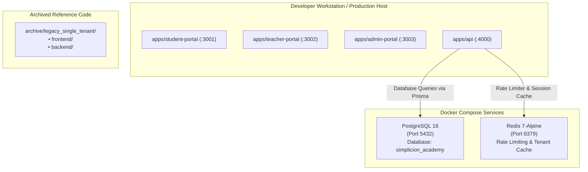

# Phase 10 Implementation Plan: Monorepo Legacy Archive, Docker Orchestration & Production Readiness

**Target Scope:** Root monorepo (`Simplicion_academy`), `archive/`, `docker-compose.yml`, `.env.example`, build pipeline.  
**Prerequisites:** Phase 9 verified (132/132 tests passing across 28 test suites).

---

## 1. Executive Summary & Objectives

Phase 10 represents the final production hardening milestone of the Simplicion Academy Multi-Tenant DDD Monorepo:
1. **Legacy Directory Archival (`archive/legacy_single_tenant/`):**
   - Cleanly retire legacy single-tenant `frontend/` and `backend/` directories to eliminate codebase clutter and ambiguity.
2. **Container Orchestration (`docker-compose.yml` & `.env.example`):**
   - Provide zero-friction developer setup with pre-configured **PostgreSQL 16** (with pgvector/multi-tenant schema) and **Redis 7** (for sliding-window rate limiting & tenant cache).
3. **Production Build & Complete Regression Verification:**
   - Execute TypeScript check and verify 100% test passing rate across the entire monorepo.

---

## 2. Architecture & Container Topology

---

## 3. Detailed Implementation Modules

### Module 10.1: Clean Legacy Codebase Retirement
- Create directory `Simplicion_academy/archive/legacy_single_tenant/`.
- Move legacy `frontend/` and `backend/` into `archive/legacy_single_tenant/` with an explanatory `README.md` documenting its deprecation in favor of the DDD monorepo architecture.

### Module 10.2: Docker Container Orchestration & Environment Configuration
- Create `Simplicion_academy/docker-compose.yml`:
  - `postgres`: Image `postgres:16-alpine`, port `5432:5432`, volume `simplicion_pgdata`, environment for user `simplicion`, password `simplicion_dev_pass_2026`, db `simplicion_academy`. Healthcheck with `pg_isready`.
  - `redis`: Image `redis:7-alpine`, port `6379:6379`, volume `simplicion_redisdata`. Healthcheck with `redis-cli ping`.
- Create `Simplicion_academy/.env.example`:
  - Complete configuration template with `DATABASE_URL`, `REDIS_URL`, `JWT_SECRET`, `RAZORPAY_KEY_ID`, `RAZORPAY_KEY_SECRET`, `RAZORPAY_WEBHOOK_SECRET`, `STORAGE_ENDPOINT`, `STORAGE_SECRET`.

### Module 10.3: Full Monorepo Build & Regression Verification
- Run TypeScript validation across all workspaces.
- Run complete test suite and assert all 28 test suites pass without regression.

---

## 4. Verification & Testing Plan

| Target | Validation Command | Success Criteria |
|---|---|---|
| Monorepo Cleanliness | `Get-ChildItem` | `frontend/` and `backend/` no longer in root; preserved in `archive/legacy_single_tenant/` |
| Docker Compose Config | `docker compose config` | Valid compose specification syntax |
| Regression Test Suite | `npx vitest run` | All 28 test suites passing (132+ tests passing) |

---

## 5. Execution Steps
1. Create `archive/legacy_single_tenant/` and archive legacy folders.
2. Create `docker-compose.yml` and `.env.example`.
3. Run monorepo test suite and verify 100% pass rate.

