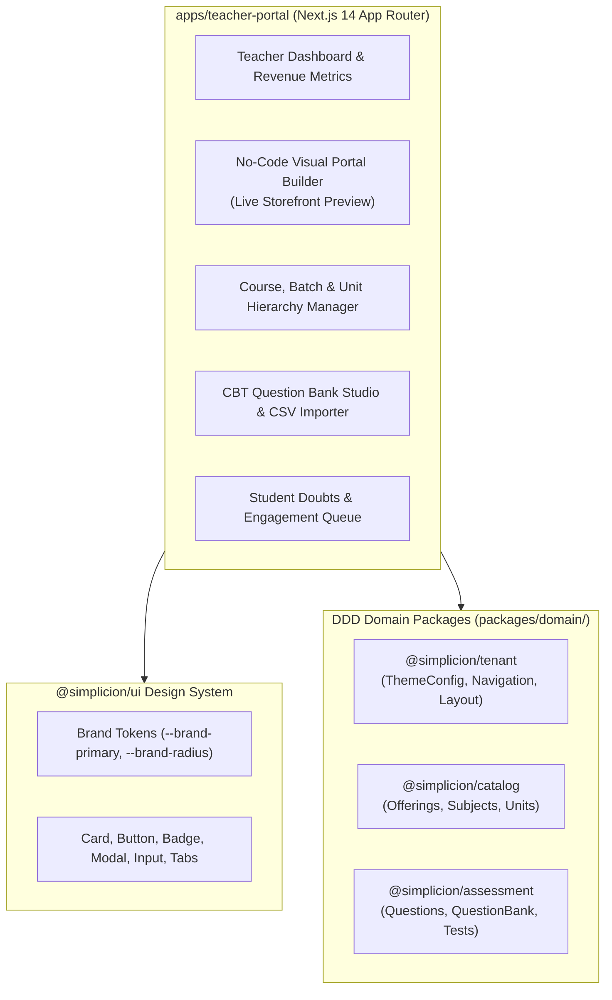

# Phase 4 Implementation Plan: Teacher Portal / Studio (`apps/teacher-portal`)

## 1. Executive Summary & Objectives
Phase 4 implements the **Teacher Portal & Studio** (`apps/teacher-portal`), the centralized workspace where educators configure their white-labeled student storefronts, assemble structured academic curriculum (Subjects, Units, Classes, Watermarked Notes, CBT Mocks), create and manage NTA CUET-standard question banks, track student analytics, and resolve student doubts.

Adhering strictly to **SAFS-00 through SAFS-06**, **SAFS-04 Design Standards**, and the **Frontend-First execution pattern**, Phase 4 develops the client-side UI and interactive state machines first, followed by backend integration with `@simplicion/tenant`, `@simplicion/catalog`, and `@simplicion/assessment`.

---

## 2. Architectural Blueprint

---

## 3. Core Modules & Step-by-Step Implementation

### Module 4.1: Project Scaffold & Dashboard (`apps/teacher-portal`)
- **Path**: `apps/teacher-portal/`
- **Setup**: Next.js 14 App Router with Tailwind CSS, Lucide icons, `@simplicion/ui`, and direct workspace references to `@simplicion/tenant`, `@simplicion/catalog`, and `@simplicion/assessment`.
- **Navigation Shell**:
  - Sidebar with institute branding, quick-switcher, and links:
    - 📊 **Overview / Dashboard** (`/`)
    - 🎨 **Visual Portal Builder** (`/builder`)
    - 📚 **Batches & Curriculum** (`/batches`)
    - 📝 **CBT Question Bank** (`/cbt`)
    - 💬 **Student Doubts** (`/doubts`)
    - 👥 **Student Roster** (`/students`)
    - ⚙️ **Settings & Razorpay Payouts** (`/settings`)
- **Dashboard Metrics**:
  - Total Enrolled Students, Gross Revenue (INR), Active Batches, CBT Completion Rate, Pending Doubts.

### Module 4.2: No-Code Visual Portal Builder (`/builder`)
- **Split-View Architecture**:
  - **Left Pane (Controls)**:
    - **Branding Tokens**:
      - Primary Color Picker (hex + preset swatches matching SAFS-04 palette).
      - Secondary Color & Accent Color.
      - Border Radius selector (`none`, `sm`, `md`, `lg`, `full`).
      - Typography selector (`Inter`, `Plus Jakarta Sans`, `Outfit`, `DM Sans`).
      - Institute Logo URL / file input and institute display name.
      - Tagline / Hero headline.
    - **Layout Configuration**:
      - Header layout variant: `centered`, `split`, `login-left`.
      - Section ordering & toggling (Hero Banner, Offerings Slider, Why Choose Us, Category Explorer, FAQ Accordion).
      - Contact & WhatsApp community number.
  - **Right Pane (Live Preview)**:
    - Interactive desktop/mobile viewport toggle displaying an embedded live render of the storefront responding instantly to changes in token state.
    - "Publish Changes" action committing updates through `TenantAggregate.updateTheme()`.

### Module 4.3: Batch & Curriculum Manager (`/batches`)
- **Batch Creator Modal & Editor**:
  - Title, slug, description, thumbnail URL.
  - Pricing & Commercial Rules: MRP, Selling Price, Discount badge, Access validity (e.g. 365 days), Max enrollment cap.
- **Curriculum Hierarchy Tree**:
  - Subject -> Chapter / Unit -> Content Items:
    - 🎥 **Video Class**: Title, duration, YouTube/Vimeo/HLS URL, downloadable resources toggle.
    - 📄 **Watermarked Notes**: PDF resource URL, page count, allow-download toggle (with security warning).
    - 🧪 **CBT Mock Test**: Linked test paper from the question bank, duration, pass percentage.

### Module 4.4: CBT Question Bank Studio & Bulk Importer (`/cbt`)
- **Question Editor**:
  - Bilingual support: English and Hindi tabs for question stem and options.
  - Question types: `single_choice`, `multiple_choice`, `numerical`.
  - Rich text prompt, explanation, and option editors.
  - Marking scheme (+4 / -1 default for CUET, configurable).
- **Bulk Importer**:
  - CSV & JSON format parser with validation (missing options, invalid answer indices, duplicate checks).
  - Preview & error highlighting before ingestion into `@simplicion/assessment`.
- **Test Paper Assembler**:
  - Combine questions into timed exams (e.g., "CUET 2027 Humanities Mock 1").
  - Set test window, attempt limits, and bilingual defaults.

### Module 4.5: Student Doubts & Community Engagement (`/doubts`)
- **Doubts Management Board**:
  - Filter by batch, subject, status (`pending`, `answered`).
  - Student query card with timestamp, attached screenshot/unit reference.
  - Teacher response editor: Markdown text, audio note placeholder, resolution tag.

---

## 4. Testing & Verification Plan

| Test File | Target Scope |
|---|---|
| `apps/teacher-portal/test/portal-builder.test.ts` | Validates live theme configuration changes, token updates, header layout switching, and preview state reactivity. |
| `apps/teacher-portal/test/curriculum-manager.test.ts` | Validates Subject -> Unit -> Content creation, deletion, reordering, and validation rules. |
| `apps/teacher-portal/test/bulk-question-importer.test.ts` | Validates CSV/JSON parsing, missing option detection, marking scheme boundary validation, and question aggregate generation. |

---

## 5. Execution Order

1. **Step 1**: Scaffold `apps/teacher-portal` package structure, `package.json`, `tsconfig.json`, and Tailwind theme configuration.
2. **Step 2**: Build UI layout shell (`Sidebar`, `TeacherHeader`, `MetricCard`) and Dashboard Overview (`/page.tsx`).
3. **Step 3**: Build No-Code Visual Portal Builder (`/builder/page.tsx` + `LiveStorefrontPreview.tsx` + `TokenCustomizer.tsx`).
4. **Step 4**: Build Batch & Curriculum Manager (`/batches/page.tsx` + `BatchEditorModal.tsx` + `CurriculumTree.tsx`).
5. **Step 5**: Build CBT Question Bank Studio (`/cbt/page.tsx` + `QuestionEditorModal.tsx` + `BulkImporterModal.tsx`).
6. **Step 6**: Build Student Doubts Queue (`/doubts/page.tsx`) and Student Roster (`/students/page.tsx`).
7. **Step 7**: Write automated test suites and verify across the monorepo.

