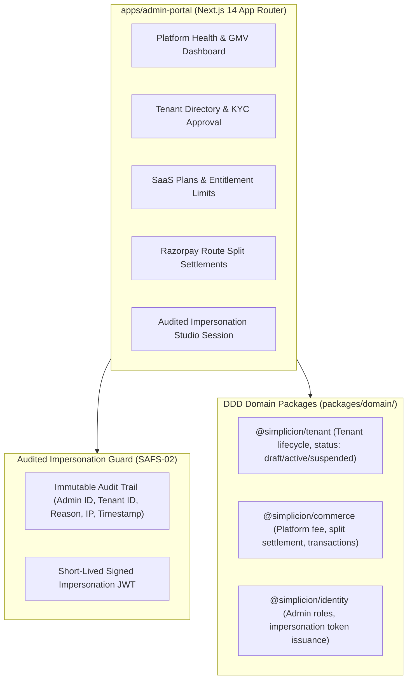

# Phase 5 Implementation Plan: Platform Super Admin Portal (`apps/admin-portal`)

## 1. Executive Summary & Objectives
Phase 5 implements the **Platform Super Admin Portal** (`apps/admin-portal`), the centralized multi-tenant control plane for platform operators to govern institute onboarding, manage SaaS subscription tiers, inspect financial split settlements, monitor platform health, and perform audited impersonation into teacher studios with mandatory cryptographic audit logging.

Adhering strictly to **SAFS-00 through SAFS-06**, **SAFS-02 Multi-Tenancy & Security**, and the **Frontend-First execution pattern**, Phase 5 develops the client-side UI first, followed by backend domain integration and automated tests.

---

## 2. Architectural Blueprint

---

## 3. Core Modules & Step-by-Step Implementation

### Module 5.1: Project Scaffold & Admin Shell (`apps/admin-portal`)
- **Path**: `apps/admin-portal/`
- **Setup**: Next.js 14 App Router with Tailwind CSS, Lucide icons, `@simplicion/ui`, and direct workspace references to `@simplicion/tenant`, `@simplicion/commerce`, and `@simplicion/identity`.
- **Navigation Shell**:
  - Sidebar with Super Admin badge and links:
    - 🌐 **Platform Overview** (`/`)
    - 🏫 **Tenant Directory & KYC** (`/tenants`)
    - 💎 **SaaS Plans & Quotas** (`/plans`)
    - 💳 **Split Settlements & Financials** (`/settlements`)
    - 🛡️ **Audited Impersonation** (`/impersonate`)
    - 📋 **System Audit Logs** (`/audit`)
- **Global Health Metrics**:
  - Total Active Institutes, Platform GMV (INR), Platform Commission Net Revenue, Active Student Count across all tenants.

### Module 5.2: Tenant Directory & KYC Approval (`/tenants`)
- **Tenant Management Board**:
  - Filter by status (`all`, `draft`, `active`, `suspended`).
  - Search by institute name, slug, owner phone/email, or custom domain.
  - Review Onboarding Applications:
    - Institute credentials, PAN / GSTIN, bank payout account details.
    - Actions: **Approve & Publish**, **Request Clarification**, **Suspend Tenant** (with mandatory reason).

### Module 5.3: SaaS Subscription Plans & Entitlements (`/plans`)
- **Plan Tier Configuration**:
  - **Starter**: 100 students, 5GB storage, 5% platform fee, shared subdomain (`*.simplicion.app`).
  - **Pro Educator**: 1,500 students, 50GB storage, 3% platform fee, custom domain support.
  - **Enterprise**: Unlimited students, 500GB storage, 1.5% platform fee, dedicated SLA, white-label mobile app.
- Real-time entitlement enforcement check: Verifies if tenant exceeds student or storage limits.

### Module 5.4: Razorpay Route Split Settlements (`/settlements`)
- **Financial Ledger**:
  - Table of split settlements across student purchases:
    - Order ID, Tenant Name, Student Mobile, Total Order Value (₹), Platform Fee (₹), Teacher Payout (₹), Transfer Status (`settled`, `pending`, `failed`).
  - Commission rate adjustments and settlement status overrides.

### Module 5.5: Audited Impersonation Engine (`/impersonate`)
- **Security Protocol (SAFS-02)**:
  - Super admin selects target tenant.
  - Admin enters mandatory **Justification / Ticket ID** (e.g., "Investigating payment webhook failure for batch enrollment").
  - System generates an audited impersonation token (`impersonatedBy: admin_id`, `tenantId: target_tenant`, `expiry: 15m`).
  - Action is written to immutable audit ledger with timestamp and client IP.
  - Direct 1-click launch into the Teacher Studio in impersonation banner mode.

---

## 4. Testing & Verification Plan

| Test File | Target Scope |
|---|---|
| `apps/admin-portal/test/tenant-governance.test.ts` | Validates tenant approval, suspension with reason, and custom domain attachment eligibility. |
| `apps/admin-portal/test/split-settlement.test.ts` | Validates platform fee calculations, split payout rounding, and ledger integrity. |
| `apps/admin-portal/test/audited-impersonation.test.ts` | Validates required justification prompt, short-lived token generation, and audit log generation. |

---

## 5. Execution Order

1. **Step 1**: Scaffold `apps/admin-portal` package structure, `package.json`, `tsconfig.json`, `tailwind.config.ts`, and `next.config.mjs`.
2. **Step 2**: Build Admin Layout Shell (`AdminSidebar`, `AdminHeader`) and Platform Overview Dashboard (`/page.tsx`).
3. **Step 3**: Build Tenant Directory & KYC Approval Board (`/tenants/page.tsx` + `TenantDetailModal.tsx`).
4. **Step 4**: Build SaaS Plans & Entitlement Manager (`/plans/page.tsx`).
5. **Step 5**: Build Razorpay Route Split Settlement Ledger (`/settlements/page.tsx`).
6. **Step 6**: Build Audited Impersonation Engine (`/impersonate/page.tsx`) with audit logger.
7. **Step 7**: Write automated tests and verify 100% pass across monorepo.

