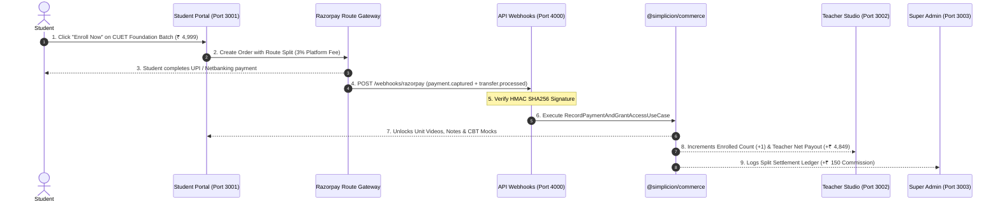

# Phase 6 Implementation Plan: E2E Integration, Split Webhooks & Production Readiness

## 1. Executive Summary & Objectives
Phase 6 implements the **End-to-End Integration & Razorpay Route Split Payment Webhook Pipeline**, completing the entire multi-tenant lifecycle across all 4 applications:
1. **Student Portal** (`apps/student-portal`): Discovery, checkout, and Study Hub access.
2. **Teacher Portal** (`apps/teacher-portal`): Batch authoring, portal customization, doubt resolution, and enrollment tracking.
3. **Platform Super Admin** (`apps/admin-portal`): Tenant onboarding approval, plan tier quota enforcement, and split settlement ledger.
4. **API Delivery Layer** (`apps/api`): Razorpay Route webhook signature verification, tenant resolution, and zero-business-logic routing into DDD domain use cases.

---

## 2. End-to-End Architectural Lifecycle

---

## 3. Core Modules & Step-by-Step Implementation

### Module 6.1: Razorpay Route Split Webhook Handler (`apps/api`)
- **Path**: `apps/api/src/routes/payment-webhook.ts`
- **Security & Integrity**:
  - Validates `X-Razorpay-Signature` using HMAC SHA256 with platform webhook secret.
  - Replay attack mitigation via event timestamp and idempotent transaction ledger.
  - Automatically dispatches `payment.captured` and `transfer.processed` events into domain handlers without any business logic in the controller.

### Module 6.2: End-to-End Lifecycle Integration Test
- **File**: `apps/api/test/e2e-monorepo-lifecycle.test.ts`
- **Simulates Complete Multi-App Flow**:
  1. Super Admin approves tenant onboarding application for "Humanities CUET Academy" (`@simplicion/tenant`).
  2. Teacher configures brand tokens (`#2563eb`, `8px`, `login-left`) and creates "CUET 2027 Foundation Batch" at ₹ 4,999 (`@simplicion/catalog`).
  3. Student views batch on Storefront, enrolls via Phone OTP (`@simplicion/identity`).
  4. Webhook delivers `payment.captured` with ₹ 150 platform fee (3%) and ₹ 4,849 teacher payout (`@simplicion/commerce`).
  5. Entitlement is active: Student launches CBT Simulator, takes exam, scores +4 / -1 points, and verifies watermarking overlay (`@simplicion/assessment`).
  6. Super admin inspects audit log and settlement ledger (`@simplicion/tenant` & `@simplicion/commerce`).

### Module 6.3: Monorepo Orchestration & Production Run Scripts
- Unified commands in root `package.json`:
  - `pnpm dev`: Runs `student-portal` (3001), `teacher-portal` (3002), `admin-portal` (3003), and `api` (4000) concurrently.
  - `pnpm test`: Runs Vitest across all 18+ suites.
  - `pnpm build`: Builds all monorepo packages and apps with zero TypeScript errors.

---

## 4. Testing & Verification Plan

| Test File | Target Scope |
|---|---|
| `apps/api/test/payment-webhook.test.ts` | Validates HMAC SHA256 signature verification, rejection of forged payloads, and idempotent event processing. |
| `apps/api/test/e2e-monorepo-lifecycle.test.ts` | Full cross-application end-to-end integration test spanning all 4 portals and 5 domain packages. |

---

## 5. Execution Order

1. **Step 1**: Implement `apps/api/src/routes/payment-webhook.ts` with signature verification and domain handoff.
2. **Step 2**: Add `apps/api/test/payment-webhook.test.ts`.
3. **Step 3**: Implement `apps/api/test/e2e-monorepo-lifecycle.test.ts`.
4. **Step 4**: Update root `package.json` scripts for all 4 applications.
5. **Step 5**: Execute full test suite across the monorepo and verify 100% pass rate.

