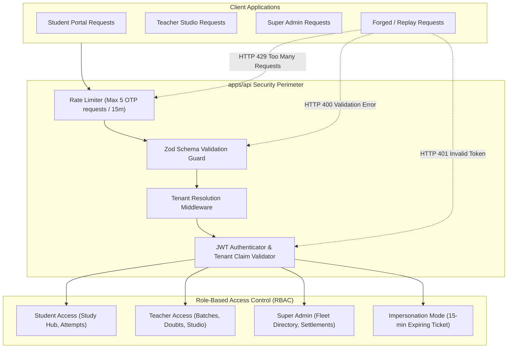

# Phase 8 Implementation Plan: Enterprise Security, Signed JWTs & Zod Validation (`apps/api`)

## 1. Executive Summary & Objectives
Phase 8 hardens the **API Delivery Layer (`apps/api`)** and presentation applications with production-grade enterprise security in strict conformance with **SAFS-02 Multi-Tenancy & Security Guidelines**. 

Phase 8 eliminates simulated credentials by implementing **cryptographically signed JSON Web Tokens (JWTs)** with tenant isolation claims, **Zod runtime schema validation** on all public endpoints, **rate-limiting guards** against SMS OTP brute-force, and the **active impersonation sticky banner** in Teacher Studio.

---

## 2. Security Architecture Blueprint

---

## 3. Core Modules & Step-by-Step Implementation

### Module 8.1: Signed JWT Token Engine (`apps/api/src/security/jwt.ts`)
Implement cryptographic token signing and verification:
- **Student Token**:
  - Payload: `{ sub: userId, tenantId, phone, role: 'student' }`
  - TTL: 7 Days
- **Teacher Token**:
  - Payload: `{ sub: teacherId, tenantId, email, role: 'teacher' }`
  - TTL: 24 Hours
- **Audited Impersonation Token (SAFS-02)**:
  - Payload: `{ sub: adminId, tenantId, role: 'superadmin', impersonated: true, ticketId, reason }`
  - TTL: **15 Minutes strictly enforced**
- **Verification Middleware**:
  - Asserts token is valid and unexpired.
  - Invariant check: Injects `req.user` and verifies `req.user.tenantId === req.tenant.id` to prevent cross-tenant token replay attacks.

### Module 8.2: Zod Runtime Input Validation Middleware (`apps/api/src/validation/`)
Define type-safe schemas rejecting malformed payloads before invoking controllers:
- `RequestOtpSchema`: Phone must match E.164 or Indian 10-digit mobile regex.
- `VerifyOtpSchema`: Phone + 6-digit numeric OTP code (`/^[0-9]{6}$/`).
- `CreateOrderSchema`: `offeringId` (non-empty string), `grossAmount` ($\ge 0$).
- `ThemeConfigSchema`: `primaryColor` (valid 6-character hex `#rrggbb`), `borderRadius` (`none`, `sm`, `md`, `lg`, `full`).
- `CreateQuestionSchema`: Prompt (EN required), options (array of min 2, max 4), correctOptionIds (non-empty).

### Module 8.3: Sliding-Window Rate Limiter (`apps/api/src/middleware/rate-limiter.ts`)
- Restricts `/auth/otp/request` to 5 attempts per 15 minutes per IP/mobile.
- Returns standard `HTTP 429 Too Many Requests` with `Retry-After` header.

### Module 8.4: Teacher Studio Active Impersonation Security Banner
- In `apps/teacher-portal/src/app/layout.tsx`:
  - When the active session contains `impersonated: true`, render a non-dismissible, high-contrast sticky yellow banner:
  - *"⚠️ AUDITED IMPERSONATION MODE: Session initiated by Super Admin for Ticket #... All actions are cryptographically logged."*
  - "Exit Impersonation Session" button that terminates session and redirects to admin console.

---

## 4. Testing & Verification Plan

| Test File | Target Scope |
|---|---|
| `apps/api/test/jwt-auth.test.ts` | Validates token signing, verification, rejection of expired tokens, and cross-tenant token replay protection. |
| `apps/api/test/zod-validation.test.ts` | Asserts malformed payloads (invalid hex, short OTP, negative price) return clean HTTP 400 with detailed schema errors. |
| `apps/api/test/rate-limiter.test.ts` | Asserts that rapid successive OTP requests trigger HTTP 429 throttling. |

---

## 5. Execution Order

1. **Step 1**: Implement `apps/api/src/security/jwt.ts` and auth verification middleware.
2. **Step 2**: Implement Zod validation schemas and middleware in `apps/api/src/validation/`.
3. **Step 3**: Implement rate-limiting middleware in `apps/api/src/middleware/rate-limiter.ts`.
4. **Step 4**: Integrate the active impersonation banner into `apps/teacher-portal`.
5. **Step 5**: Write automated test suites and verify 100% pass across the monorepo.

