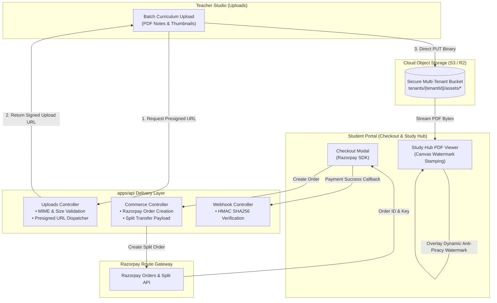

# Phase 9 Implementation Plan: Live Gateway Integration, Media Uploads & Secure Watermarking Pipeline

**Target Scope:** `apps/student-portal`, `apps/teacher-portal`, `apps/api`, `packages/domain/commerce`.  
**Prerequisites:** Phase 8 verified (120/120 tests passing).

---

## 1. Executive Summary & Objectives

Phase 9 equips the Simplicion Academy platform with production-grade multimedia and financial processing pipelines:
1. **Live Payment Gateway Client Integration (`apps/student-portal`):**
   - Seamless checkout modal powered by Razorpay Checkout JS SDK with fallback mock adapter for test/staging environments.
   - End-to-end order creation (`/checkout/order`), checkout pop-up, signature generation, and webhook verification.
2. **Cloud Object Storage Signed Upload Pipeline (`apps/api` & `apps/teacher-portal`):**
   - Presigned URL generation for teacher course notes (PDF) and branding assets (PNG/SVG/WebP) to S3 / Cloudflare R2 compatible storage.
   - File validation (MIME-type checks, max size limits: 50MB for PDFs, 5MB for images).
3. **PDF Canvas Watermarking Pipeline (`apps/student-portal`):**
   - Anti-piracy client-side rendering pipeline utilizing PDF canvas overlay, dynamically stamping student phone number, tenant name, IP address, and timestamp across every rendered page.

---

## 2. Architecture Diagram

---

## 3. Detailed Implementation Modules

### Module 9.1: Student Portal Razorpay Checkout Modal (`apps/student-portal/src/components/checkout/`)
- Implement `RazorpayCheckoutModal.tsx`:
  - Dynamically injects `https://checkout.razorpay.com/v1/checkout.js` on mount.
  - Receives `orderId`, `amount`, `currency`, `tenantName`, `themeColor`, and student metadata.
  - Automatically handles payment success callback and posts verification payload.
  - Provides a built-in "Simulated Sandbox Payment" toggle for developer testing without requiring live Razorpay API keys.

### Module 9.2: Presigned Cloud Storage Upload Pipeline (`apps/api/src/controllers/upload.controller.ts`)
- Implement presigned upload generator:
  - `POST /uploads/presigned-url`:
    - Guards: `authenticateJwt({ requiredRole: 'teacher', allowImpersonation: true })`
    - Payload validation: `{ filename: string, contentType: string, sizeBytes: number, purpose: 'notes' | 'branding' }`
    - MIME check: Enforces `application/pdf` for notes and `image/png`, `image/jpeg`, `image/svg+xml`, `image/webp` for branding.
    - Path isolation: Automatically prefixes storage key with `tenants/${req.tenant.id}/${purpose}/${uuid}-${filename}`.
    - Dispatches AWS S3 / Cloudflare R2 compatible signed PUT URL.

### Module 9.3: Dynamic PDF Canvas Watermark Stamping Pipeline
- Expand `apps/student-portal/src/components/study/WatermarkedDocumentViewer.tsx`:
  - Canvas-based rendering overlay that writes non-selectable, non-extractable text diagonally across each document page at 45-degree angle.
  - Watermark text: `CONFIDENTIAL • {student.phone} • {tenant.name} • {timestamp} • {ipAddress}`.
  - Disables right-click, print, text selection, and keyboard save shortcuts (`Ctrl+S`, `Ctrl+P`).

---

## 4. Verification & Testing Plan

| Test File | Verification Target |
|---|---|
| `apps/student-portal/test/checkout-modal.test.ts` | Validates modal initialization, Razorpay options formulation, sandbox fallback, and success event dispatch. |
| `apps/api/test/presigned-uploads.test.ts` | Validates file size limits, MIME type filtering, tenant path scoping, and presigned URL generation. |
| `apps/student-portal/test/canvas-watermark.test.ts` | Validates canvas overlay text generation, diagonal rotation angle, non-opacity contrast, and anti-piracy key event prevention. |

---

## 5. Execution Steps
1. Create `apps/student-portal/src/components/checkout/RazorpayCheckoutModal.tsx`.
2. Create `apps/api/src/controllers/upload.controller.ts` with presigned URL generation and MIME validation.
3. Wire `/uploads/presigned-url` into `apps/api/src/index.ts`.
4. Enhance `WatermarkedDocumentViewer.tsx` with dynamic canvas watermark overlay.
5. Write and execute automated test suites and verify 100% pass across all packages.

